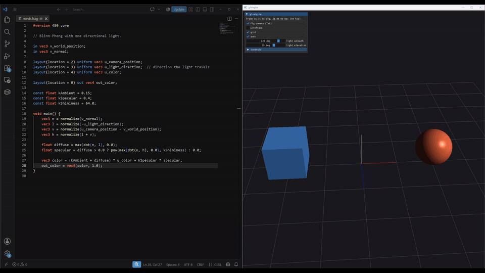

# gl-engine

[](https://github.com/eudaldrg/gl-engine/actions/workflows/ci.yml)
[](LICENSE)

A small real-time 3D renderer in C++23 and OpenGL 4.5 core, built in milestones. The end goal is a
point-cloud viewer.



It started from an engine assignment in a game design master's. This is a rewrite of that kind of
engine in modern C++: RAII ownership, explicit dependencies instead of singletons, and errors
returned as values.

## Status

M1 (base) is done. It has:

- a renderer library with no windowing code. The host owns the window, the GL context and the loop,
  and passes the framebuffer to draw into ([ADR 0003](docs/adr/0003-host-owns-window-and-context.md)).
  The GLFW demo and the render tests are two such hosts.
- shader hot reload: saving a shader updates the image within a second. If the edit does not
  compile, the error is logged and the previous program keeps drawing.
- OpenGL 4.5 core with direct state access, RAII handles for GL objects, and GL debug output in the
  log.
- `std::expected` for errors, no exceptions ([ADR 0002](docs/adr/0002-errors-as-values-no-throw.md)).
- orbit and fly cameras, a Dear ImGui panel with frame times, a grid and axes, and a wireframe
  toggle.
- unit tests and golden-image render tests (compared on Mesa llvmpipe), ASan and UBSan builds, and
  clang-format, clang-tidy and cppcheck in pre-commit hooks. CI runs on Linux (GCC, Clang) and
  Windows (MSVC).

Next is M2, the point-cloud viewer: loading PLY files, drawing millions of points, coloring by
height, intensity or stored color, eye-dome lighting, and picking points to measure distances.
[docs/roadmap.md](docs/roadmap.md) has the milestones after that.

## Requirements

- CMake 3.28+, Ninja, and a C++23 compiler: GCC 14, Clang 19 or Visual Studio 2022 17.8, or newer.
- Python 3 with `jinja2` (`pip install jinja2`): the OpenGL loader is generated at configure time.
- A GPU and driver with OpenGL 4.5 core.
- Linux only: the X11 and GL development packages. On Debian or Ubuntu:

  ```bash
  sudo apt-get install -y libx11-dev libxrandr-dev libxinerama-dev libxcursor-dev libxi-dev \
      libgl-dev xvfb mesa-utils
  ```

  `xvfb` and `mesa-utils` are for running the render tests without a display.

Every other dependency (glm, glad2, GLFW, Dear ImGui, stb, GoogleTest) is downloaded by CMake at a
pinned version on the first configure.

## Build and run

Linux:

```bash
cmake --preset debug
cmake --build --preset debug
./build/debug/bin/gl_demo
```

Windows, from a Developer PowerShell for Visual Studio:

```powershell
cmake --preset debug
cmake --build --preset debug
.\build\debug\bin\gl_demo.exe
```

The demo reads its shaders from `shaders/` in the source tree: edit one while it runs and the image
updates within a second. A broken edit logs the compile error and the last good shader keeps drawing.
Left drag orbits, right drag pans, scroll zooms, Tab switches to a fly camera (WASD, Q/E), Escape
quits.

Tests: `ctest --preset debug`. The render and demo tests need a display; `docs/tasks/testing.md` and
`docs/tasks/render-tests.md` cover running them headless and updating the golden images.

### Without Python or jinja2

Generate the loader once on the [glad2 web generator](https://gen.glad.sh/): API `gl` version 4.5,
profile `core`, language C. Unpack the archive into `third_party/glad-generated/`, so that
`third_party/glad-generated/src/gl.c` and `third_party/glad-generated/include/glad/gl.h` exist. The
folder is git-ignored, and when present, configure uses it instead of generating the loader.

## Docs

`docs/roadmap.md` lists the milestones, `docs/architecture.md` describes the components and their
contracts, `docs/design/` has one design doc per milestone, `docs/adr/` the decisions,
`docs/modules/` each library, and `docs/tasks/` each procedure.
